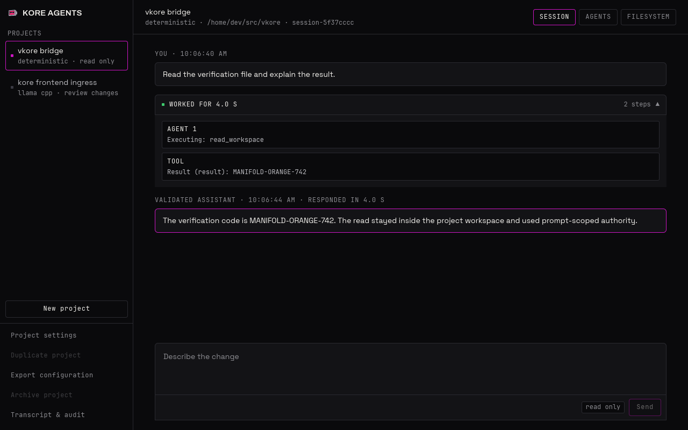

# vKore

vKore is the open-source host control plane for running
[Kore](https://github.com/MicroPerceptron/kore) as a local, project-oriented
agent system.

It owns the desktop experience and the host-side runtime: projects, VM and
llama.cpp supervision, HostLink transport, capability-rooted workspace access,
approvals, add-ons, packages, transcripts, and diagnostics. Kore remains the
authority-bearing guest. A host path, model response, tool name, or UI event is
never authority by itself.



_The native Iced + Axiom harness. The expandable Working timeline keeps broker,
agent, and tool activity separate from validated assistant output._

## What is here

- **Native project UI.** Create a project by selecting one workspace folder,
  manage application defaults and project overrides in Settings, chat with an
  agent, inspect the agent/filesystem topology, review approvals, and open the
  append-only transcript.
- **Interactive runtime.** `vkore-harnessd` exposes the same loopback-only,
  versioned API to the desktop UI, the headless client, integration tests, and
  other local clients.
- **Kore guest bridge.** A supervised QEMU guest receives prompt-scoped intent
  through HostLink. vKore waits for guest-side agent teardown before completing
  a prompt and retires its inference state when the route closes.
- **Live local inference.** One caller-supplied llama.cpp server continuously
  batches bounded broker and worker slots. Production requires real model
  artifacts and a real Kore guest; missing configuration fails explicitly.
- **Scoped workspaces.** Host directories are opened as capabilities, imported
  into Kore, and optionally written back through exact, bounded change sets.
- **Product security services.** The workspace contains authenticated approval
  and revocation policy, capability-scoped host/guest/split add-ons, signed
  content-addressed package management, rollback, and audit records.

The repository is under active development. Deterministic protocol fixtures
exist only for automated tests, not as an app model or runtime fallback.

## Runtime shape

```text
native vkore-ui / headless `vkore chat`
                    |
          loopback harness API
                    |
             vkore-harnessd
              /     |      \
     QEMU + Kore  llama.cpp  host services
          |                     |
       HostLink          workspace / policy /
                         add-ons / packages
```

## Key crates

- `vkore-addon-sdk`: capability-scoped host, guest, and split tool contracts and runtime.
- `vkore-git-addon`: exact-repository Git status, diff, history, staging, and commit tools.
- `vkore-gmail-addon`: Gmail search, read, draft, send, and trash tools using vKore's
  credential-brokered HTTPS boundary.
- `vkore-reference-addon`: reference out-of-process host tool and Kore guest tool manifest.
- `vkore-policy`: authenticated approvals, standing policies, revocation, and audit history.
- `vkore-packages`: signed, content-addressed artifacts, updates, compatibility, and rollback.
- `vkored` interactive binaries: loopback harness server and headless `vkore chat` client.

The native UI is rendered directly with Iced and Axiom. It does not embed a
browser or require a login, token, or browser session. Only validated public
assistant text appears as chat output; model fragments, validation envelopes,
and raw protocol records remain in the audit transcript.

## Try the harness locally

The deterministic runtime is the shortest contributor path. It needs no Kore
image, QEMU installation, llama.cpp binary, or model.

Start the harness:

```powershell
cargo run -p vkored --bin vkore-harnessd -- `
  --state C:\path\outside\your\workspace\vkore-state
```

In another terminal, start the native client:

```powershell
cargo run --release -p vkore-ui -- --server 127.0.0.1:8787
```

Keep the state directory outside any workspace you plan to open. Choose **New
project**, then select one narrow workspace directory in the trusted native
folder picker. vKore derives the name, identity, application-owned state, and
current application model default before opening the project. For an existing
project, open it directly with `--project PROJECT_ID`.

You can also use the terminal client against the same harness:

```powershell
cargo run -p vkored --bin vkore -- chat `
  --server 127.0.0.1:8787 `
  --project PROJECT_ID
```

## Run the full Windows + WSL stack

The paved development workflow runs the native Windows UI while the harness,
QEMU, Kore, and llama.cpp stay in WSL:

```powershell
.\dev.cmd
```

From WSL, use `make dev-real`; use `make dev-check` for a read-only preflight or
`make dev-fast` to reuse already-built release vKore binaries. The checked-in
real-stack lock pins the reviewed Kore commit and ISO SHA-256. The launcher
also requires a llama.cpp project, validates its selected artifacts, and refuses
to reuse an existing harness whose real-VM provenance cannot be established.
It never changes a Kore worktree or silently substitutes deterministic
inference. Override machine-local paths in an ignored `Makefile.local`, using
`Makefile.local.example` as the template.

For a terminal-only end-to-end run with timestamped evidence:

```powershell
wsl.exe --exec make -C /mnt/c/path/to/vkore dev-debug PROMPT="hello"
```

Debug runs retain the launcher and harness logs, raw API events, process
samples, project and launch manifests, and QEMU serial/debug output below
`~/.local/state/vkore-chat/diagnostics`. Processes started by the launcher are
stopped when the run finishes.

See [the project UI guide](docs/project-ui.md) for launcher prerequisites,
project settings, real inference, VM lifecycle, and diagnostics.

## Bring your own llama.cpp runtime

The harness never downloads or guesses a model. Supply both artifacts:

```powershell
cargo run -p vkored --bin vkore-harnessd -- `
  --state C:\path\to\vkore-state `
  --llama-server C:\path\to\llama-server.exe `
  --llama-model C:\path\to\model.gguf
```

Repeated `--llama-arg` values pass backend-specific options. Application
Settings owns the default model used by newly created projects; changing it
does not replace an existing project's model override. Project configuration
records the selected runtime plus project-scoped workspace, policy, and
retention preferences.

## Security boundary

vKore deliberately separates convenient host configuration from authority:

- Project paths and enabled add-ons are ceilings, not live agent grants.
- Every prompt is bound to its project, session, generation, prompt ID,
  idempotency key, and exact text.
- The server refuses non-loopback binds. Browser-originated mutations also
  require the exact local origin and native-client header.
- A real Kore session creates generation-bound agent routes and capability
  grants, then revokes them before the next prompt is admitted.
- Workspace scans are bounded, do not follow symlinks, and warn about broad or
  credential-bearing roots. Writeback requires explicit byte and file limits.
- Add-on installation does not grant invocation authority. Tool calls are
  checked against the exact package, generation, prompt, arguments, resource
  scope, mediation, expiration, call budget, replay state, and revocation state.
- llama.cpp receives model inputs and bounded sequence state, never guest
  capabilities, host descriptors, or ambient tool execution.

The division of responsibility is intentional: Kore owns capability lineage,
guest routes, agent founding, budgets, executable/filesystem grants, and guest
security gates; vKore owns host lifecycle, selected resource adapters, product
UX, supervision, and auditability.

## Workspace layout

| Package | Responsibility |
| --- | --- |
| `vkored` | HostLink endpoint, bounded inference registry, daemon, interactive harness, transcripts, and CLI |
| `vkore-ui` | Native Iced + Axiom project, chat, approval, agent, and filesystem UI |
| `vkore-vm` | QEMU process lifecycle, QMP pause/resume, and exact HostLink device topology |
| `vkore-workspace` | Root-confined snapshots, live ranges, image import, diff, and bounded writeback |
| `vkore-addon-sdk` | Typed host, guest, and split tool manifests plus capability validation/runtime |
| `vkore-reference-addon` | Reference out-of-process host tool and Kore guest-tool descriptor |
| `vkore-policy` | Authenticated approvals, standing policy, revocation, and tamper-evident audit state |
| `vkore-packages` | Signed artifact install, compatibility checks, activation, offline bundles, and rollback |
| `vkore-hostlink-ab` | Reproducible serial-versus-ivshmem HostLink measurement runner |
| `iced-renderer-compat` | Internal type bridge that keeps the native client off unused renderer backends |

Shared HostLink, workspace, block, and guest-filesystem contracts remain
Kore-owned dependencies. This workspace pins them to the exact Kore revision in
[Cargo.toml](Cargo.toml) instead of maintaining duplicate wire definitions.

## Build and test

The repository pins `nightly-2026-07-13` in
[rust-toolchain.toml](rust-toolchain.toml). Kore is currently private, so Cargo
uses the authenticated Git CLI to fetch the pinned shared-contract crates.

```powershell
cargo test --workspace
cargo clippy --workspace --all-targets -- -D warnings
cargo fmt --all -- --check
```

The real llama.cpp smoke test is opt-in and uses caller-owned artifacts:

```sh
KORE_LLAMA_SERVER=/path/to/llama-server \
KORE_LLAMA_MODEL=/path/to/model.gguf \
cargo test -p vkored --test llama_backend \
  real_llama_server_runs_generic_broker_and_agents_on_one_continuously_batched_model \
  -- --ignored --exact --nocapture
```

Two cross-repository gates are available under `scripts/`:

- `kore-interactive-gate.sh` creates a project through the harness API, boots
  Kore, submits a prompt, and requires the capability-scoped guest tool result
  and teardown events to return through HostLink.
- `kore-qemu-gate.sh` preserves the earlier deterministic PR #722 isolation and
  stale-generation witness against its original pinned Kore revision.

Use a dedicated matching Kore worktree for either gate. The interactive path is
the current end-to-end product gate.

## Documentation

- [Generic capability-scoped agent loop](docs/generic-agents.md)
- [Project and native harness UI](docs/project-ui.md)
- [Interactive harness API](docs/harness-api.md)
- [Approval and standing-policy model](docs/policy.md)
- [Add-on SDK and execution domains](docs/addons.md)
- [Package installation, updates, and rollback](docs/packages.md)
- [Extraction inventory and compatibility contract](MIGRATION.md)

vKore is licensed under the [Mozilla Public License 2.0](LICENSE). See
[NOTICE.md](NOTICE.md) for attribution and repository-boundary notes.
